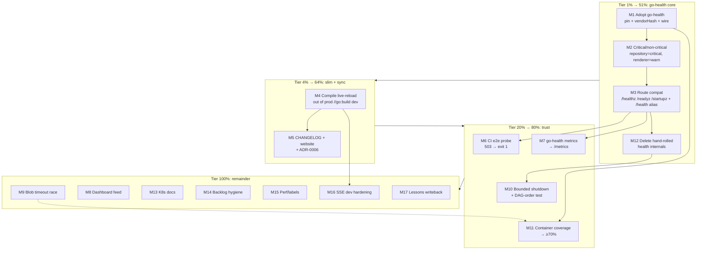

# Health Architecture Plan — go-health Integration, Degraded Visibility, Prod Slimming

|            |                                                                                                                                                                                                                              |
| ---------- | ---------------------------------------------------------------------------------------------------------------------------------------------------------------------------------------------------------------------------- |
| Date       | 2026-11-01 02:13                                                                                                                                                                                                             |
| Basis      | Session review + fixes (docs/status/2026-11-01_01-30, _01-56), user decisions Q1–Q3, TODO_LIST.md, ROADMAP.md, prior plan 2026-09-27                                                                                         |
| Method     | Pareto breakdown (1% → 4% → 20% → 100%), medium tasks 30–100 min, fine tasks ≤12 min, all sorted by impact/effort/customer-value                                                                                             |
| North star | **Do not reinvent health checking.** `github.com/larsartmann/go-health` is a purpose-built Kubernetes probe SDK for samber/do v2 containers — the exact gap this project hand-rolled. Integrate it; delete our ad-hoc layer. |

---

## 1. Decisions Locked by the User (2026-11-01)

| Q                                          | Decision                                    | Consequence                                                                                                                                                       |
| ------------------------------------------ | ------------------------------------------- | ----------------------------------------------------------------------------------------------------------------------------------------------------------------- |
| Q1: probe semantics under repository blips | **Use `go-health` + `go-health-dashboard`** | Three-probe model (liveness never checks deps; readiness 503 only for _critical_ failures; startup for slow boots). Hand-rolled `/health` internals get absorbed. |
| Q2: D2 renderer unavailable                | **`degraded` (warn), still 200**            | Renderer becomes a **non-critical** go-health check → `status: warn`, HTTP 200, visible in payload.                                                               |
| Q3: `/api/live-reload`                     | **Compile out of production**               | Build-tag split (`//go:build dev`); release binaries (Docker/goreleaser/nix) contain no SSE code path at all.                                                     |

**go-health fit (verified against its README/go.mod this session):**

- `health.New(injector, health.WithCriticalServices("repository"), health.WithVersion(...))` — consumes our **existing** do injector directly.
- `probe.Start(ctx)` / `probe.Shutdown()`; `probe.RegisterRoutes(mux, health.DefaultRoutes())`.
- Non-critical failure → `"status": "warn"` + HTTP 200 (exactly Q2's answer, natively).
- Critical failure → fail/503 (preserves this session's truthful-`/health` fix and ADR-0005's restart contract).
- Uses `encoding/json/v2` and samber/do v2.1.0 — same as this repo; no GOEXPERIMENT or version conflict.
- Ships metrics + aggregation + federation (feeds `go-health-dashboard`).

---

## 2. Pareto Breakdown

| Tier     | Share of result | Contents                                                                                                                                                                                                                                                                                               |
| -------- | --------------- | ------------------------------------------------------------------------------------------------------------------------------------------------------------------------------------------------------------------------------------------------------------------------------------------------------ |
| **1%**   | **51%**         | **M1–M3: integrate go-health with critical/non-critical classification and route compatibility.** This single decision replaces the entire hand-rolled health layer, natively encodes both user decisions (warn/200 degradation, three-probe semantics), and keeps the Docker restart contract intact. |
| **4%**   | **64%**         | 1% **+ M4 (compile live-reload out of prod) + M5 (contract sync: CHANGELOG/website/ADR) + M12 (delete absorbed hand-rolled code — dedupe is where the real simplification lands)**                                                                                                                     |
| **20%**  | **80%**         | 4% **+ M6 (CI e2e probe verification) + M7 (go-health metrics) + M10 (shutdown hardening: bounded ctx + DAG-order test) + M11 (container coverage raise)**                                                                                                                                             |
| **100%** | last 20%        | 20% **+ M8 (dashboard feed), M9 (blob timeout race), M13 (k8s docs), M14–M17 (backlog hygiene, perf, SSE-dev hardening, lessons) + §6 roadmap remainder (not planned in fine detail)**                                                                                                                 |

---

## 3. Comprehensive Plan — Medium Tasks (30–100 min each)

Sorted by importance/impact/effort/customer-value. P0 = do first.

| ID      | Task                                                                                                                                                                                                                           | Impact | Effort | Value                 | Deps   |
| ------- | ------------------------------------------------------------------------------------------------------------------------------------------------------------------------------------------------------------------------------ | ------ | ------ | --------------------- | ------ |
| **M1**  | **Adopt go-health**: pin `v0.8.1`, wire `health.New(injector, …)` into `container.New`, `probe.Start`/`Shutdown` in main lifecycle, nix `vendorHash` repair (go.mod changes ⇒ gotcha 18)                                       | 🔥🔥🔥 | 90m    | High                  | —      |
| **M2**  | **Critical/non-critical mapping**: `repository` critical; `renderer` non-critical returning `OffError` when D2 absent → native `warn`/200 degradation                                                                          | 🔥🔥🔥 | 60m    | High                  | M1     |
| **M3**  | **Route compatibility**: register go-health `DefaultRoutes` (`/healthz`, `/readyz`, `/startupz`); keep `GET /health` as readiness alias so the `healthcheck` subcommand + Docker HEALTHCHECK (ADR-0005) stay contract-green    | 🔥🔥🔥 | 60m    | High                  | M1     |
| **M12** | **Delete absorbed hand-rolled health code**: `handleHealth` internals → go-health response; `Server.HealthCheck` stays as `do.HealthcheckerWithContext` adapter; remove dead `repositoryHealth` remnants                       | 🔥🔥   | 45m    | High (simplification) | M3     |
| **M4**  | **Compile live-reload out of prod**: `//go:build dev` split (`livereload_dev.go`/`livereload_prod.go` stub), nil-safe `LiveReload()` accessor, AGENTS command updates (`go run -tags dev`), verify release builds carry no tag | 🔥🔥   | 90m    | Med-High              | —      |
| **M5**  | **Contract sync**: CHANGELOG entry (503 + warn/200 + route set), website docs update, ADR-0006 draft (three-probe adoption, supersedes parts of ADR-0005 wiring)                                                               | 🔥🔥   | 45m    | Med-High              | M3, M4 |
| **M6**  | **CI e2e probe verification**: boot with broken root → `/readyz` 503 → `healthcheck` subcommand exit 1; plus unit test for exit-1 path if missing                                                                              | 🔥🔥   | 60m    | High (trust)          | M3     |
| **M7**  | **Metrics**: enable go-health prometheus metrics, merge into `/metrics`, test presence                                                                                                                                         | 🔥     | 45m    | Med                   | M1     |
| **M10** | **Shutdown hardening**: `probe.Shutdown` + `injector.ShutdownWithContext(shutdownTimeout)` in main; DAG-wave order test (cache after server)                                                                                   | 🔥     | 45m    | Med                   | M1     |
| **M11** | **Container coverage** 53.5% → ≥70%: `New()` failure paths, renderer degradation, blob timeout                                                                                                                                 | 🔥     | 60m    | Med                   | M1     |
| **M9**  | **Blob-provider timeout race**: close the abandoned goroutine's repository if it completes post-deadline                                                                                                                       | 🔥     | 45m    | Med                   | —      |
| **M8**  | **go-health-dashboard feed**: read its SDK/federation docs, decide embedded-SDK vs federation URL, spike in dev mode, document decision                                                                                        | 🔥     | 100m   | Med                   | M1     |
| **M13** | **K8s docs**: three-probe wiring, `start-period` vs 10s blob boot alignment, sample manifests                                                                                                                                  | 🔥     | 45m    | Med                   | M3     |
| **M14** | **Backlog hygiene**: templ drift check, otel re-pin watch note, GHSA postcss note, social-preview checklist pointer                                                                                                            | 🔥     | 60m    | Low-Med               | —      |
| **M15** | **Perf/labels**: `/health` benchmark refresh (real probe per request now), `cache` sub-block → `cache_stats` rename or real failure mode                                                                                       | 🔥     | 30m    | Low-Med               | M12    |
| **M16** | **SSE dev hardening** (dev binaries only): heartbeat comments, client cap, tests                                                                                                                                               | 🔥     | 45m    | Low                   | M4     |
| **M17** | **Lessons writeback**: gotchas (exit-code-atomic gates; fixtures-are-specs) in AGENTS.md; cross-project pipeline-masking lesson to crush-config repo (separate commit there)                                                   | 🔥     | 30m    | Low-Med               | —      |

---

## 4. Detailed Breakdown — Fine Tasks (≤12 min each)

All medium tasks decomposed. Sorted globally by execution order within dependency tiers.

### Tier 1% — go-health core (M1 → M2 → M3 → M12)

| ID  | Parent | Task                                                                                                                          | Est |
| --- | ------ | ----------------------------------------------------------------------------------------------------------------------------- | --- |
| F1  | M1     | Read go-health FEATURES.md/TODO_LIST.md for maturity caveats before pinning                                                   | 10m |
| F2  | M1     | `go get github.com/larsartmann/go-health@v0.8.1` + `go mod tidy`                                                              | 10m |
| F3  | M1     | Repair nix `vendorHash` (`buildflow -s nix-hash-fix`), then `nix flake check --impure` (gotcha 18)                            | 30m |
| F4  | M1     | Add `probe := health.New(injector, WithCriticalServices("repository"), WithVersion(...))` in `container.New`                  | 12m |
| F5  | M1     | Expose probe via container accessor; `probe.Start(ctx)` in main; `probe.Shutdown()` in `shutdownServices`                     | 12m |
| F6  | M1     | Unit test: probe construction + first batch against in-process container                                                      | 12m |
| F7  | M2     | Classify `repository` critical (already via WithCriticalServices — assert `ErrUnknownCriticalService` fires for typo'd names) | 12m |
| F8  | M2     | Register `renderer` as named non-critical check; return `health.Off("d2 binary unavailable")` when `provideRenderer` degraded | 12m |
| F9  | M2     | Test: renderer off ⇒ `warn` + 200; repository fail ⇒ `fail` + 503                                                             | 12m |
| F10 | M2     | Map go-health `Status` → this repo's log vocabulary in the access log for `/health*` routes                                   | 12m |
| F11 | M3     | `probe.RegisterRoutes(mux, health.DefaultRoutes())` in `Server.Handler()` (probe passed in)                                   | 12m |
| F12 | M3     | `GET /health` alias → readiness handler (ADR-0005 compat; subcommand untouched)                                               | 12m |
| F13 | M3     | Decide + test `healthcheck` subcommand target: keep `--addr …/health` (alias) — pin with test                                 | 12m |
| F14 | M3     | Local Docker run: HEALTHCHECK green with healthy root, red with broken root                                                   | 12m |
| F15 | M12    | `handleHealth` → serve go-health readiness payload (or 307 to `/readyz` — pick one, document)                                 | 12m |
| F16 | M12    | Keep `Server.HealthCheck(ctx)` as adapter over probe state (do.HealthcheckerWithContext contract intact)                      | 12m |
| F17 | M12    | Delete dead code: `repositoryHealth`, superseded payload maps, now-unused constants                                           | 12m |
| F18 | M12    | Full gates: build + `go test ./... -race` + `golangci-lint run` (unmasked) + `config verify`                                  | 12m |

### Tier 4% — prod slimming + contract sync (M4, M5)

| ID  | Parent | Task                                                                                                             | Est |
| --- | ------ | ---------------------------------------------------------------------------------------------------------------- | --- |
| F19 | M4     | Design note: `//go:build dev` / `//go:build !dev` file split; keep `-dev` flag semantics (cache/watch) unchanged | 12m |
| F20 | M4     | Split `livereload.go` → `livereload_dev.go` (real) + `livereload_prod.go` (stub: nil hub, no-op Close)           | 30m |
| F21 | M4     | Nil-safe `Server.LiveReload()` + route registration only in dev build                                            | 12m |
| F22 | M4     | Tests: run server tests with `-tags dev` too; add CI matrix leg                                                  | 12m |
| F23 | M4     | AGENTS.md Essential Commands: `go run -tags dev ./cmd/dynamic-markdown-site -dev -root ./content`                | 12m |
| F24 | M4     | Verify release paths build **without** the tag: Dockerfile, goreleaser, nix flake                                | 12m |
| F25 | M5     | CHANGELOG: 503 readiness, warn/200 degradation, new routes, live-reload compiled out                             | 12m |
| F26 | M5     | Website docs: health endpoints table + semantics                                                                 | 30m |
| F27 | M5     | ADR-0006: adopt go-health three probes; ADR-0005 remains valid (subcommand), wiring section annotated            | 12m |

### Tier 20% — trust & robustness (M6, M7, M10, M11)

| ID  | Parent | Task                                                                                      | Est |
| --- | ------ | ----------------------------------------------------------------------------------------- | --- |
| F28 | M6     | CI job: build binary, boot with unreadable root, assert `/readyz` = 503                   | 30m |
| F29 | M6     | Same job: `healthcheck --addr` exits 1                                                    | 12m |
| F30 | M6     | Unit test `runHealthcheck` exit-1 path against a 503 server (if coverage missing)         | 12m |
| F31 | M7     | Enable go-health prometheus metrics option                                                | 12m |
| F32 | M7     | Merge health metrics into `/metrics` handler                                              | 12m |
| F33 | M7     | Test: metric families present after first sweep                                           | 12m |
| F34 | M10    | `shutdownServices`: `probe.Shutdown()` then `injector.ShutdownWithContext(30s)`           | 12m |
| F35 | M10    | Test: shutdown wave order — server before cache/blob (assert via order-recording doubles) | 30m |
| F36 | M11    | Test `New()` failure path shuts the injector down (blob timeout + bad storage URL)        | 12m |
| F37 | M11    | Test `provideRenderer` degradation marks probe warn (not fail)                            | 12m |
| F38 | M11    | Test blob-provider timeout returns `errBlobTimeout` and leaks nothing (race detector)     | 12m |
| F39 | M11    | Coverage report re-run; file gap list if <70%                                             | 12m |

### Tier 100% — remainder (M8, M9, M13–M17)

| ID  | Parent | Task                                                                                                  | Est |
| --- | ------ | ----------------------------------------------------------------------------------------------------- | --- |
| F40 | M9     | Blob provider: closable result channel; close abandoned repo if constructed late                      | 30m |
| F41 | M9     | Test the late-completion path                                                                         | 12m |
| F42 | M8     | Read go-health-dashboard README/SDK + federation docs                                                 | 30m |
| F43 | M8     | Decision note: embedded SDK vs federation (dev-only first)                                            | 12m |
| F44 | M8     | Spike: dashboard renders this site's probe in dev compose                                             | 30m |
| F45 | M8     | Document the dashboard decision in ROADMAP/ADR                                                        | 12m |
| F46 | M13    | K8s doc page: liveness/readiness/startup wiring + probes table                                        | 30m |
| F47 | M13    | `start-period` ≥ blob boot (10s) alignment guidance + example                                         | 12m |
| F48 | M14    | Run `templ generate` drift check (CI parity)                                                          | 5m  |
| F49 | M14    | TODO_LIST: otel re-pin + GHSA postcss watcher notes refreshed                                         | 12m |
| F50 | M14    | Social preview: confirm it's a manual step, link from TODO_LIST (done already)                        | 5m  |
| F51 | M14    | markdownlint/buildflow spot-check on new docs                                                         | 12m |
| F52 | M15    | `/health` benchmark update (probe-backed)                                                             | 12m |
| F53 | M15    | Rename `cache` health sub-block → `cache_stats` (or implement a real failure mode)                    | 12m |
| F54 | M16    | SSE heartbeat comment every 15s (dev build)                                                           | 12m |
| F55 | M16    | Client cap (e.g. 64) with 503 on overflow (dev build)                                                 | 12m |
| F56 | M16    | Tests for heartbeat + cap                                                                             | 12m |
| F57 | M17    | AGENTS gotcha: exit-code-atomic gates (no `cmd \| tail &&` patterns)                                  | 12m |
| F58 | M17    | AGENTS gotcha: fixtures-are-specs (re-read fixtures on contract change)                               | 12m |
| F59 | M17    | Cross-project lesson (pipeline masking) → crush-config `references/lessons.md` (own repo, own commit) | 12m |

### Remainder (not fine-planned — ROADMAP fuel, verify-open per Step 0)

Still open in TODO_LIST/ROADMAP, out of this plan's fine scope: GHSA-rj75 postcss upstream watch · otel v1.47 stable re-pin · social preview upload (manual) · search autocomplete/indexing/Bleve · cache warming/Redis · benchmark CI tracking · draft preview · diagram export/zoom · content versioning · WYSIWYG preview · dark mode · syntax themes · keyboard nav. These stay in ROADMAP; HARVEST picks them up if promoted.

---

## 5. Execution Graph

Parallelism: M4 is independent of Tier 1% and can start immediately in parallel; M9 likewise. Everything else chains off M1→M3.

---

## 6. Verschlimmbessern Guardrails (non-negotiable)

1. **ADR-0005 contract preserved**: the `healthcheck` subcommand keeps exit-0-on-200 / exit-1-otherwise and probes an endpoint whose verdict reflects _readiness_. `/health` alias must 503 on critical failure — this session's fix must not regress.
2. **No GOEXPERIMENT drift**: go-health uses `encoding/json/v2` (Go 1.27+) — same standard as this repo (gotcha 12); all go commands stay `env -u GOTOOLCHAIN GOEXPERIMENT=jsonv2`.
3. **go.mod/go.sum change ⇒ nix repair**: `buildflow -s nix-hash-fix` + `nix flake check --impure` **before any push** (gotcha 18). The 60s budget can phantom-fail — re-run once.
4. **`Container.HealthCheck` accessor survives** (public API + tests) — its internals may delegate to the probe.
5. **Full gates after every medium task**: build, `go test ./... -race`, unmasked `golangci-lint run` (exit code!), `config verify`.
6. **Dev workflow must not degrade**: `-dev` flag semantics unchanged; the build tag only gates live-reload. AGENTS.md commands updated in the same change (F23).
7. **Release paths build without the dev tag** — verified explicitly (F24) so goreleaser/nix/Docker never ship SSE code.
8. **Tests run under both build variants** once the tag exists (F22) or the dev path rots silently.
9. **One behavior-change tier at a time**: land M1–M3 (+M12) before M4/M5 touch docs — never mix semantic and packaging changes in one commit.

---

## 7. Errata (Step-0 verification: what's already done / still open)

- Verified **done** this session (do not re-plan): truthful `/health` 503, blob/cache `Shutdown` + guards, `Container.HealthCheck`, single shutdown owner, eager `do.Provide` server, SSE `Close()` + devMode gate, AGENTS gotchas 7/21, FEATURES `/health` row.
- Verified **still open** in TODO_LIST: GHSA-rj75 postcss watch, social preview (manual), otel re-pin.
- Prior plan `2026-09-27_04-35` items: superseded/completed per TODO_LIST checkboxes — no re-dispatch.
- go-health pinned at **v0.8.1 alpha** upstream; its own TODO/FEATURES read (F1) is the gate before pinning in case of known-breaking internals pre-v1.

---

## 8. Execution Protocol

1. Await approval of this plan.
2. Then execute tier by tier (1% → 4% → 20% → 100%), finest-task granularity, gates after every medium task, `git status` + detailed commit after each completed task, push at tier boundaries.
